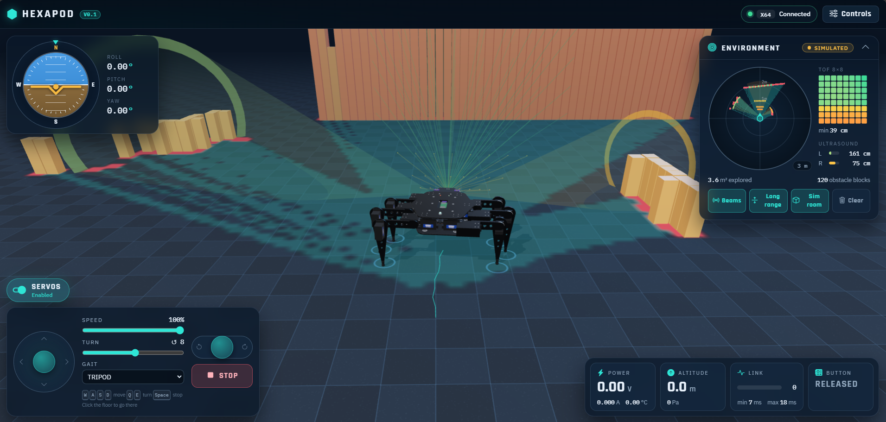
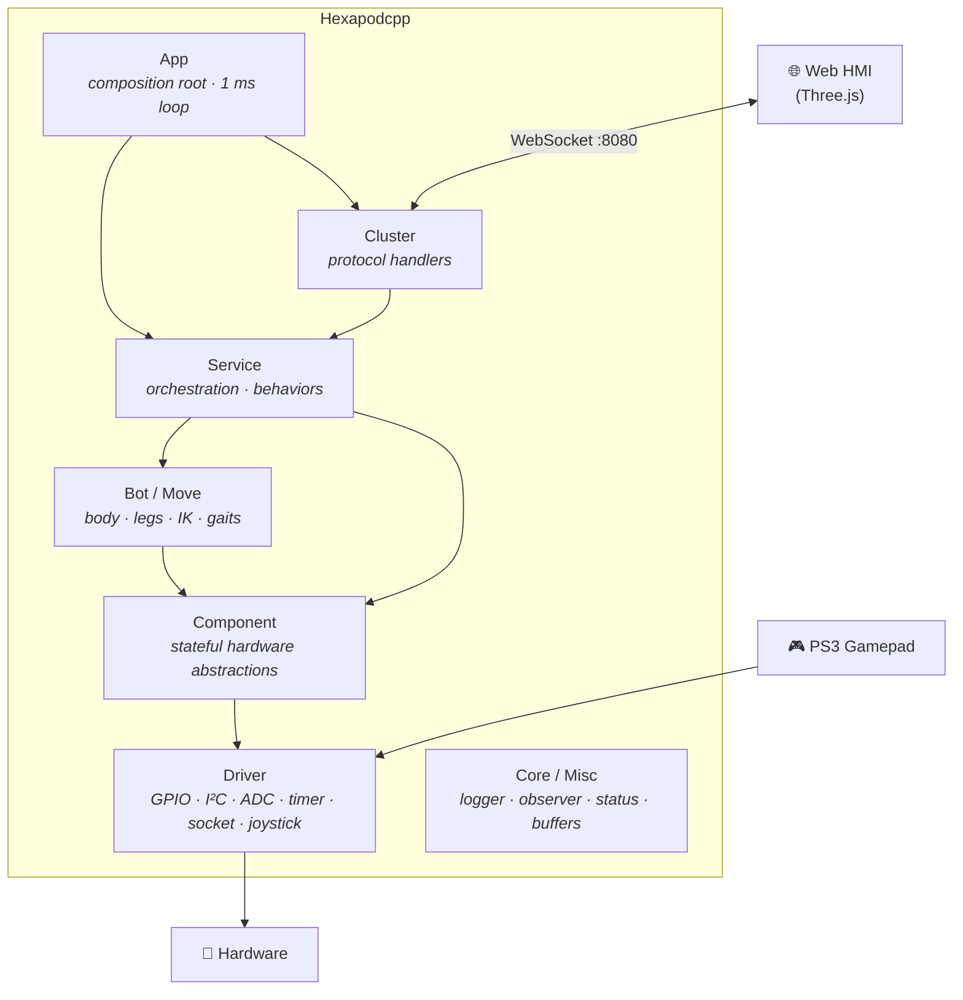
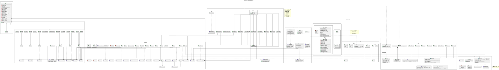
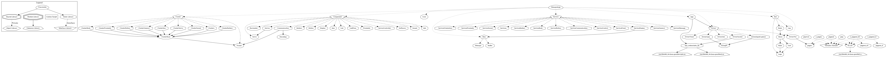
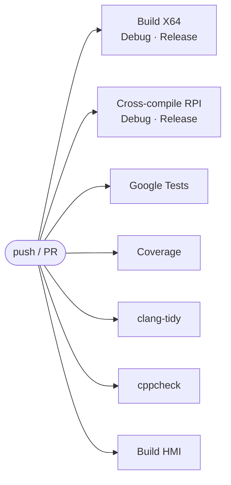

<div align="center">

# 🕷️ Hexapodcpp

**A modern C++17 brain for a six-legged robot — running on a Raspberry Pi Zero 2 W, driven from a 3D web cockpit.**

[](https://github.com/berryerlouis/Hexapodcpp/actions/workflows/build.yaml)


[](LICENSE)



[Features](#-features) •
[Quick start](#-quick-start) •
[Architecture](#-architecture) •
[Build](#-building) •
[Test](#-testing--quality) •
[Raspberry Pi](#-raspberry-pi-deployment) •
[Protocol](#-communication-protocol) •
[HMI](#-web-hmi)

</div>

---

## ✨ Features

- 🦿 **18-DOF locomotion** — 6 legs × 3 joints with inverse kinematics and **Tripod**, **Wave** and **Ripple** gaits.
- 🧭 **Sensor fusion** — MPU-9150 IMU + AHRS, barometer, ultrasonic (SRF05) and laser ToF (VL53L5X) proximity sensing.
- 🔋 **Power awareness** — battery voltage/current monitoring through an ADS1115 ADC.
- 🔊 **Sound reaction** — GPIO sound-detection sensor with LED feedback.
- 🎮 **Multiple controls** — PS3 gamepad (`/dev/input/js0`), keyboard, virtual stick or point-and-go from the browser.
- 🌐 **Live 3D web cockpit** — Vite + TypeScript + Three.js HMI connected over WebSocket.
- 🧱 **Clean layered architecture** — Driver → Component → Service → Cluster, observer pattern, dependency injection.
- ⚙️ **Embedded-friendly** — no exceptions, fixed-size containers, static composition, deterministic 1 ms main loop.
- 💻 **Runs anywhere** — full simulation build on X64, cross-compiled to ARM64 with Docker for the real robot.
- ✅ **Quality gates** — GoogleTest/GMock suite, coverage, cppcheck and clang-tidy in CI.

---

## 🚀 Quick start

> On Windows, run every script through WSL: `wsl bash bin/dev/<script>.sh ...`

```bash
# 1. Prerequisites (Debian/Ubuntu/WSL)
sudo apt install build-essential cmake git nodejs npm
#   optional: ccache docker.io lcov cppcheck clang-tidy

# 2. Build & run the controller on your PC (simulation)
bin/dev/build.sh X64 sources DEBUG
./build/hexapod-X64-DEBUG/src/Hexapodcpp

# 3. Run the unit tests
bin/dev/test.sh all

# 4. Start the web cockpit, then open http://localhost:5173
cd HMI && npm install && npm run dev
```

---

## 🧠 Architecture

The application is a strictly layered system wired together in a single composition root
([src/App/App.cpp](src/App/App.cpp)). Every layer only depends on the layers below it.



| Layer | Folder | Responsibility |
|---|---|---|
| **App** | [src/App](src/App) | Instantiates and initializes everything in order, runs `Update(currentTime)` every tick |
| **Cluster** | [src/Cluster](src/Cluster) | Decodes request frames, executes commands, builds responses / NACKs |
| **Service** | [src/Service](src/Service) | Business behavior: control, orientation, battery, proximity, display, sound… |
| **Bot** | [src/Bot](src/Bot) | Physical model: body, legs, kinematics |
| **Move** | [src/Move](src/Move) | Gait cycle, gait strategies and walk trajectories |
| **Component** | [src/Component](src/Component) | Hardware devices with observable state (`ComponentInterface` + `Attach()`/`Notify()`) |
| **Driver** | [src/Driver](src/Driver) | Low-level OS/hardware access, with `X64` and `RPI` implementations |
| **Core / Misc** | [src/Core](src/Core), [src/Misc](src/Misc) | Logging macros, observer base, status codes, bitmaps, buffers |

<details>
<summary>📐 Detailed diagrams</summary>





```bash
# Regenerate the PlantUML diagram
docker run --rm -v $PWD:/ws -w /ws plantuml/plantuml -tsvg images/architecture.puml

# Regenerate the CMake target graph
bin/dev/graphviz.sh
```

</details>

---

## 🔩 Hardware

| Function | Device | Bus |
|---|---|---|
| Main board | Raspberry Pi Zero 2 W (ARM64) | — |
| Servo controllers | 2 × PCA9685 (`0x40` right, `0x41` left) driving 18 servos | I²C |
| IMU | MPU-9150 (accel / gyro / magnetometer) + AHRS fusion | I²C |
| Barometer | Pressure / altitude sensor | I²C |
| Battery monitor | ADS1115 16-bit ADC | I²C |
| Laser ToF | VL53L5X multizone ranging | I²C |
| Ultrasound | 2 × SRF05 (left / right) | GPIO input capture |
| Display | SSD1306 OLED | I²C |
| Feedback & inputs | LEDs, PWM LEDs, buttons, sound-detection sensor | GPIO |
| Remote | PS3 controller (USB / Bluetooth) | `/dev/input/js0` |

---

## 🛠️ Building

### Build script

```bash
bin/dev/build.sh [TARGET] [MODE] [BUILD_TYPE] [install]
```

| Argument | Values | Default |
|---|---|---|
| `TARGET` | `X64`, `RPI` | `RPI` |
| `MODE` | `sources`, `test` | `sources` |
| `BUILD_TYPE` | `DEBUG`, `RELEASE`, `CLEAN` | `DEBUG` |
| `install` | RPI only — build & install WiringPi system-wide | — |

```bash
bin/dev/build.sh X64 sources DEBUG     # → build/hexapod-X64-DEBUG/src/Hexapodcpp
bin/dev/build.sh X64 sources RELEASE   # → build/hexapod-X64-RELEASE/src/Hexapodcpp
bin/dev/build.sh X64 sources CLEAN     # remove X64 DEBUG + RELEASE build directories
bin/dev/build.sh X64 test              # → build/hexapod-X64-TEST/unittests/HexapodcppTest
```

> 💡 `compile_commands.json` is always generated, and **ccache** is picked up automatically when installed
> (disable with `-DHEXAPOD_USE_CCACHE=OFF`).

### 🐳 Cross-compile for the Raspberry Pi (Docker)

No ARM toolchain to install: a Debian Trixie image ([Dockerfile.rpi-zero2](Dockerfile.rpi-zero2)) provides
`aarch64-linux-gnu-g++` and WiringPi, and the repo is mounted for fast incremental builds.

```bash
bin/dev/docker-build-rpi.sh            # Release (default) → ./Hexapodcpp
bin/dev/docker-build-rpi.sh DEBUG      # Debug build
bin/dev/docker-build-rpi.sh RELEASE CLEAN

# Reuse an already built/pulled toolchain image (as CI does)
TOOLCHAIN_IMAGE=hexapodcpp:rpi-toolchain HEXAPOD_SKIP_IMAGE_BUILD=1 bin/dev/docker-build-rpi.sh
```

Output: `build/hexapod-RPI-<BUILD_TYPE>/src/Hexapodcpp`, copied to `./Hexapodcpp`.

<details>
<summary>⚙️ Manual CMake configuration</summary>

```bash
# X64
cmake -S . -B build/gcc-debug -DTARGET=X64 -DCMAKE_BUILD_TYPE=Debug -Wno-dev
cmake --build build/gcc-debug --target Hexapodcpp --parallel $(nproc)

# Raspberry Pi (native build on the Pi)
cmake -S . -B build/gcc-release -DTARGET=RPI -DCMAKE_BUILD_TYPE=Release -Wno-dev
cmake --build build/gcc-release --target Hexapodcpp --parallel $(nproc)

# Unit tests
cmake -S . -B build/hexapodTest -DTARGET=X64 -DGTEST=ON -DCMAKE_BUILD_TYPE=Debug -Wno-dev
cmake --build build/hexapodTest --target HexapodcppTest --parallel $(nproc)
```

| CMake option | Default | Description |
|---|---|---|
| `TARGET` | `X64` | `X64` (simulation) or `RPI` (real hardware) |
| `GTEST` | `OFF` | Build the unit test executable instead of the application |
| `HEXAPOD_USE_CCACHE` | `ON` | Use ccache as compiler launcher when found |
| `HEXAPOD_TEST_PRECOMPILE_HEADERS` | `ON` | Precompile GoogleTest/GMock headers |

Third-party dependencies are fetched automatically with `FetchContent`:
[TinyWebsockets](https://github.com/berryerlouis/TinyWebsockets),
[WiringPi](https://github.com/WiringPi/WiringPi) and [pigpio](https://github.com/joan2937/pigpio) (RPI),
[GoogleTest](https://github.com/google/googletest) (tests).

</details>

### 📦 Production release

```bash
bin/prod/build.sh
```

Runs clang-format → unit tests → X64 Release → RPI Release (Docker) → UML regeneration.

---

## 🧪 Testing & quality

```bash
bin/dev/test.sh                       # build + run all tests (shuffled)
bin/dev/test.sh all                   # same, and write build/hexapod-X64-TEST/test_results.xml
bin/dev/test.sh UT_MOVE_GAIT_CYCLE    # run a single test suite
```

The script exits non-zero if the build or any test fails.

| Tool | Command | Output |
|---|---|---|
| 📊 Coverage (lcov) | `bin/dev/coverage.sh` | `coverage-report/index.html` |
| 🔍 cppcheck | `bin/dev/cppcheck.sh` | `cppcheck_html/`, `cppcheck-report.xml` |
| 🧹 clang-tidy | `bin/dev/clang-tidy.sh` (`CLANG_TIDY=clang-tidy-20` to pick a version) | `clang-tidy-report/report.txt` |
| 🎨 clang-format | `bin/dev/clang-format-all.sh` | formats `src/` and `unittests/` in place |

### 🤖 Continuous integration

Every push and pull request runs [build.yaml](.github/workflows/build.yaml):



Binaries, test results, and coverage/static-analysis reports are published as workflow artifacts.

Pushes to `develop` also run [pages.yaml](.github/workflows/pages.yaml), which deploys the project site from [site/](site) and the live cockpit (built from [HMI/](HMI)) to GitHub Pages.

---

## 🍓 Raspberry Pi deployment

<details>
<summary><b>1. Prepare the Pi</b></summary>

```bash
sudo apt update
sudo apt install build-essential cmake git libssl-dev

# Enable I²C: uncomment dtparam=i2c_arm=on
sudo nano /boot/firmware/config.txt
sudo modprobe i2c-dev
echo i2c-dev | sudo tee -a /etc/modules

# Optional: pair the PS3 controller
sudo bin/dev/setup-ps3-controller.sh --usb
```

</details>

<details>
<summary><b>2. Install the systemd service</b></summary>

`/etc/systemd/system/hexabot.service`:

```ini
[Unit]
Description=Hexabot Robot Controller
After=network-online.target
Wants=network-online.target

[Service]
Type=simple
User=root
WorkingDirectory=/home/hexabot
ExecStart=/home/hexabot/Hexapodcpp
Restart=on-failure
RestartSec=3s

[Install]
WantedBy=multi-user.target
```

```bash
sudo systemctl daemon-reload
sudo systemctl enable --now hexabot.service
journalctl -u hexabot.service -e
```

</details>

<details>
<summary><b>3. Build, deploy & debug from your PC</b></summary>

The scripts expect an SSH host alias named `hexabot`.

```bash
bin/dev/docker-build-rpi.sh DEBUG   # cross-compile
bin/dev/deploy-to-rpi.sh            # stop service, copy ./Hexapodcpp to the Pi
bin/dev/run-rpi.sh                  # run it
bin/dev/start-gdb-rpi.sh            # or start gdbserver for remote debugging
```

VS Code tasks (`Build & Deploy to RPi`, `Build, Deploy & Debug RPi`) and launch configurations chain these steps.

</details>

---

## 📡 Communication protocol

The HMI talks to the robot over a **WebSocket on port `8080`** using compact, hex-encoded ASCII frames
delimited by `<` and `>` in both directions.

```
<CC MM NN [PP PP …]>

Request :  <040100>        → Battery / GET_VOLTAGE, 0 parameter bytes
Response:  <04010202EE>    → 2 parameter bytes: 0x02 0xEE
```

| Field | Size | Meaning |
|---|---|---|
| `CC` | 1 byte | Cluster ID |
| `MM` | 1 byte | Command ID within the cluster |
| `NN` | 1 byte | Number of parameter bytes |
| `PP` | `NN` bytes | Parameters |

| ID | Cluster | ID | Cluster |
|---|---|---|---|
| `00` | General (reset, version, execution time) | `04` | Battery |
| `01` | IMU | `05` | Body |
| `02` | Proximity | `06` | Button |
| `03` | Servo | `07` | Sound |

Invalid requests are answered with a NACK frame. Cluster and command IDs live in
[src/Cluster/Constants.h](src/Cluster/Constants.h) and are mirrored in
[HMI/src/communication/clusters](HMI/src/communication/clusters).

---

## 🌐 Web HMI

A Vite + TypeScript + Three.js cockpit in [HMI/](HMI): a live 3D hexapod model, sensor HUD, gait and
body controls, and keyboard / gamepad / virtual stick / point-and-go driving.

```bash
cd HMI
npm install
npm run dev      # http://localhost:5173
npm run build    # type-check + production bundle in HMI/dist
```

On startup, choose a target: **X64** (local simulation at `127.0.0.1:8080`) or **Hexapod** (the real robot).

The published cockpit is at https://berryerlouis.github.io/Hexapodcpp/app/ (the project page is at the site root).

---

## 🗂️ Project layout

```
Hexapodcpp/
├── src/                  # Firmware sources (App, Bot, Cluster, Component, Core, Driver, Misc, Move, Service)
├── unittests/            # GoogleTest / GMock suites and mocks
├── HMI/                  # Web cockpit (Vite + TypeScript + Three.js)
├── bin/dev/              # Build, test, analysis, deploy scripts
├── bin/prod/             # Release pipeline
├── cmake/                # Cross-compilation toolchain
├── images/               # Architecture diagrams & screenshots
└── Dockerfile.rpi-zero2  # ARM64 cross-compilation image
```

---

## 🤝 Contributing

1. Keep layers separated and wire new modules in the relevant `CMakeLists.txt`.
2. Follow the conventions: `INIT("Name", obj.Initialize())`, layer logging macros (`LOG_COMPONENT_*`, `LOG_SERVICE_*`, `LOG_CLUSTER_*`), no exceptions, explicit constructor initialization lists.
3. Before opening a PR, run `bin/dev/clang-format-all.sh` and `bin/dev/test.sh all`.

Bug reports and feature requests: [open an issue](https://github.com/berryerlouis/Hexapodcpp/issues/new/choose).

---

## 📄 License

Distributed under the **GNU GPL v3** — see [LICENSE](LICENSE).

<div align="center">

Made with ❤️ by Louis BERRYER, C++ and a lot of servo jitter.

</div>
